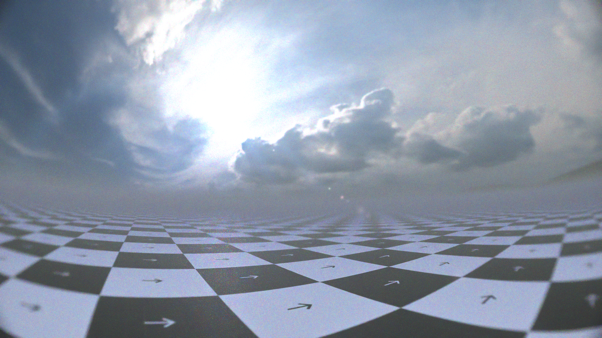

# objektif

**Real, physical, procedural lens for Blender.** A Geometry Nodes glass element that sits in front of your camera. Cycles traces every camera ray going through it, so the wide field of view, the fisheye distortion, the round image edge, the colour fringing and the fall-off toward the edge are all real refraction. None of it is a post effect or a lens shader.

The rig solves the curvature of the glass to achieve the desired FOV. When changing the camera's focal length, sensor or resolution, instead of moving multiple optical components (like a real objective would do), the glass re-shapes itself to achieve the same effect.

## Requirements

- **Blender 5.1** (the file is saved with 5.1)
- **Cycles.** The glass uses Ray Portal BSDF

## Quick start

1. Open `objektif.blend` and look through the camera (`Numpad 0`). Render with Cycles.
2. Select the **Physical Lens** object and open its **Physical Lens Rig**
   modifier. The **Lens** panel has the controls you need most: Field of
   View, Format and Chromatic Aberration.
3. To use the lens in your own scene, append the `Physical Lens` object from
   `objektif.blend` and point its **Mount on Camera** constraint at your camera.

[docs/README.md](docs/README.md) walks through setup, every control, and what to
do when the rig shows a warning.


| The basic 50 mm camera | The same camera through objektif at 180° |
|---|---|
| 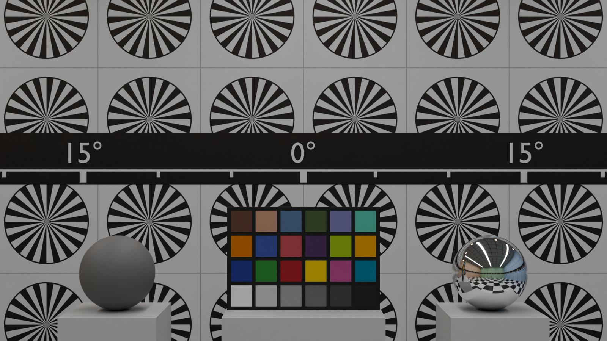 | 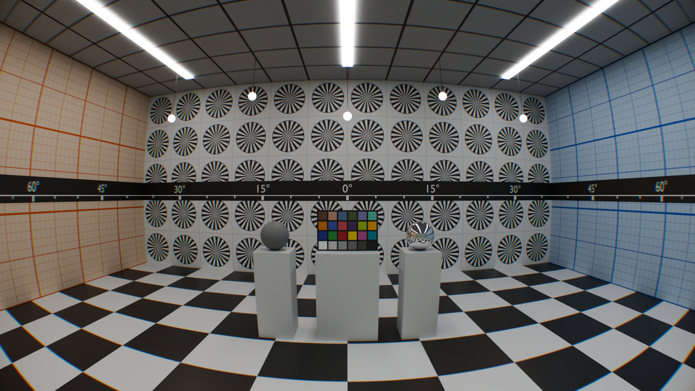 |

### Field of View

| 100° | 140° | 180° |
|---|---|---|
| 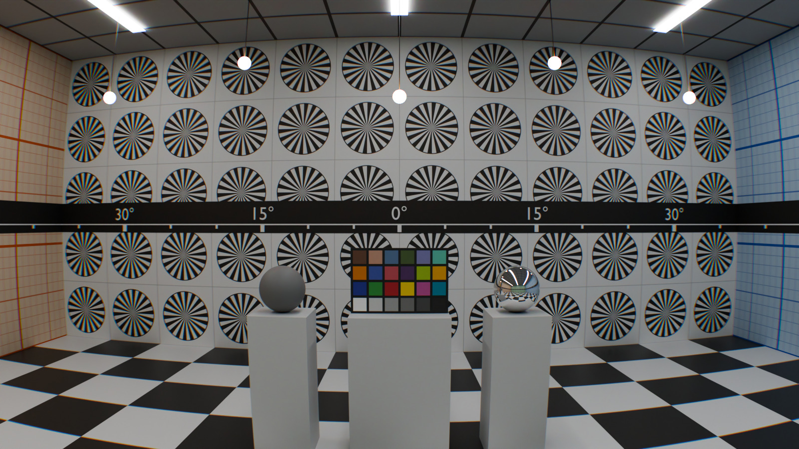 | 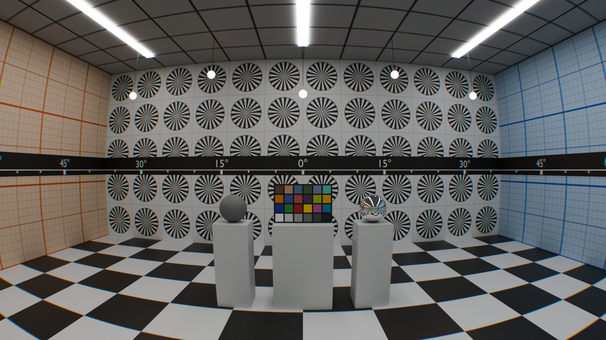 |  |

### Format

| Circular | Custom (Image Circle 1.5) | Full Frame |
|---|---|---|
| 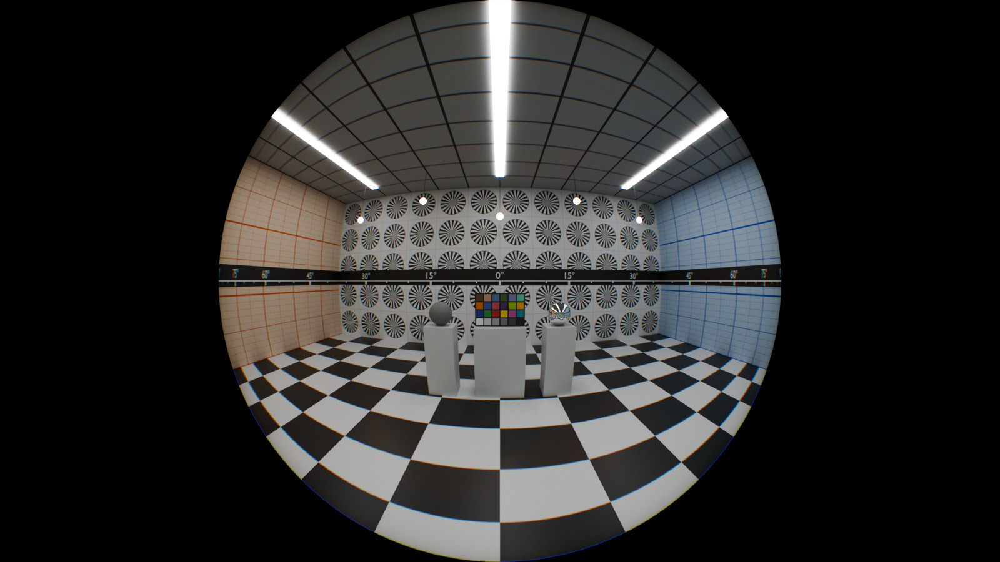 | 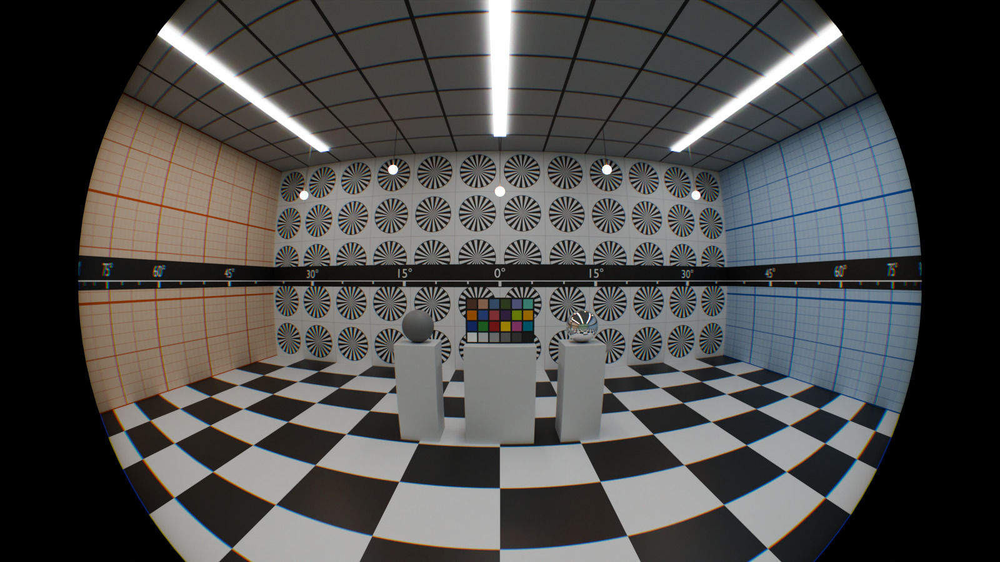 |  |

### Chromatic Aberration

The right edge of the 180° picture, enlarged 2×:

| 0 (none) | 0.2 (like crown glass) | 1 (heavy) |
|---|---|---|
| 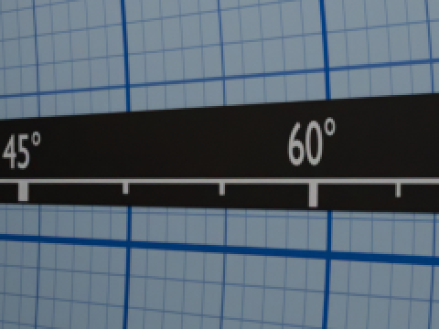 | 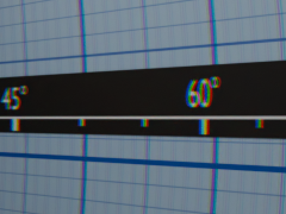 | 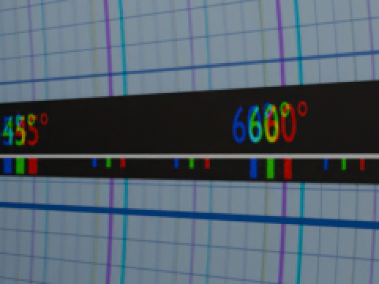 |

### Aperture

A 100° picture focused on the ColorChecker. A bulb hangs 1.2 m behind it:

| Spiral (round) | Grid (square) | Squeeze 2 (anamorphic) |
|---|---|---|
| 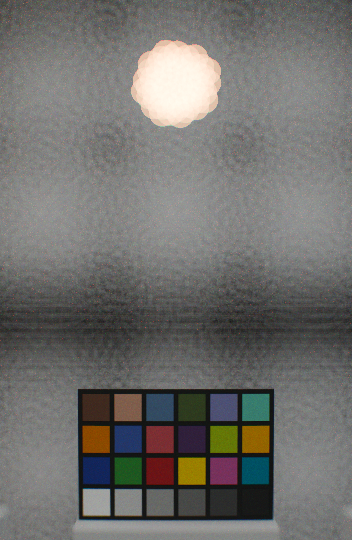 | 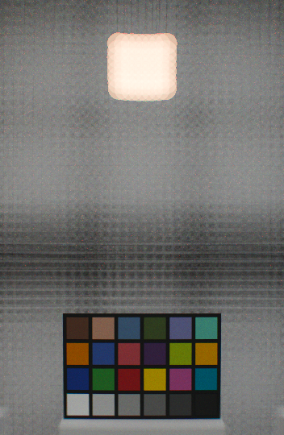 | 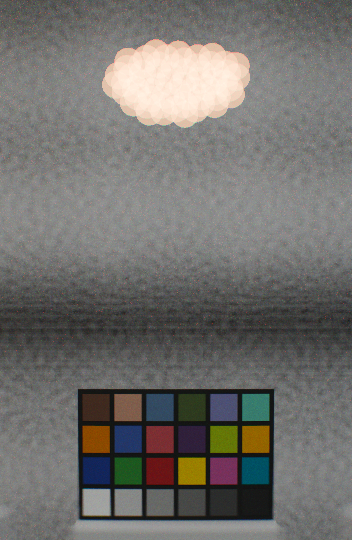 |

### Sensor

The ColorChecker at **1 sample per pixel** with no denoising, enlarged 3×:

| Stochastic | Mono | Filter Array |
|---|---|---|
| 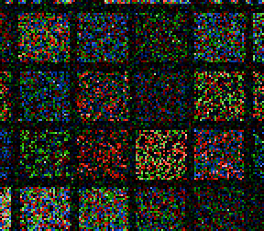 | 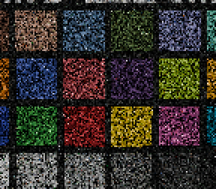 | 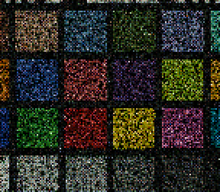 |

### Barrel and mount

| Barrel off (Custom, Image Circle 0.6) | The camera tilted up 35° (Circular) |
|---|---|
| 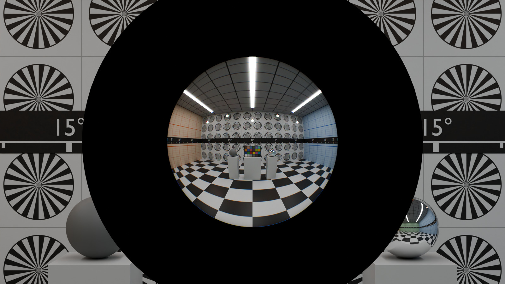 | 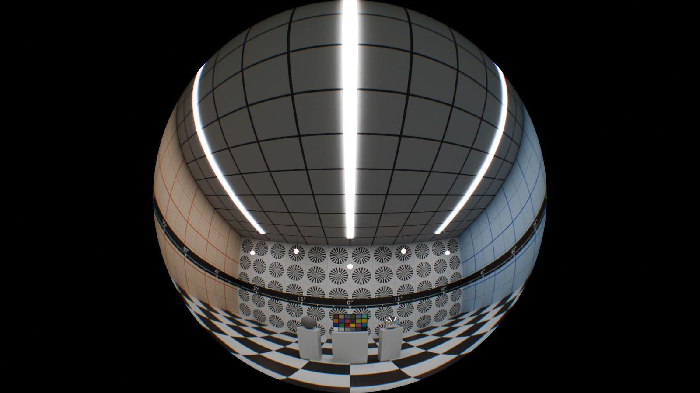 |


### Render the examples yourself

```
blender -b --factory-startup -P build_lab.py   # builds lab.blend around the lens of ../objektif.blend
blender -b lab.blend -P render_lab.py          # renders the pictures above into ../docs/lab/
```

Add `-- --list` to see the shot names, or `-- with_lens fov_100` to render only
those shots. Before each shot, the script reads the lens's own messages. It
stops on any warning, or if the lens does not reach the Field of View it asked
for.

## Credits

- The demo scene's sky, [`hdri/htl_free_002.exr`](hdri/htl_free_002.exr), is a
  frame of the
  [Free HDRi Sky timelapse](https://hdrmaps.com/freebies/free-hdri-sky-timelapse/)
  by HDRMAPS.com (Grzegorz Wronkowski), under [CC BY](hdri/CC-BY-license.txt).
  It was downscaled to 2048 × 1024 and re-encoded (half float, DWAA).
- *UV Map Grids* by Paco Salas, from
  [BlenderKit](https://www.blenderkit.com) (Royalty Free).