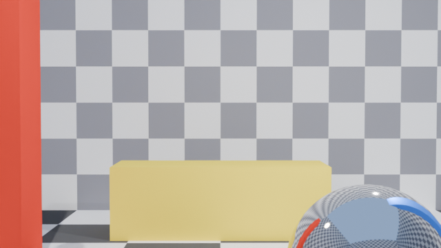
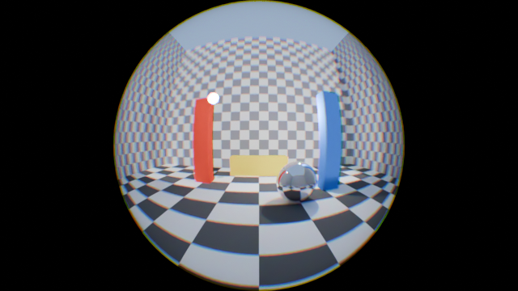

# objektif documentation

- [How it works](#how-it-works)
- [Setup](#setup)
- [Scene rules](#scene-rules)
- [Controls](#controls)
- [Warnings](#warnings)
- [Checking a design without Blender](#checking-a-design-without-blender)

## How it works

objektif is one object, **Physical Lens**, with one Geometry Nodes modifier,
**Physical Lens Rig**. The modifier builds a glass element about 0.1 m in front
of the camera: a concave bowl that faces the camera and a gently domed front
that faces the world. A black barrel around the bowl makes the round image edge.

The camera itself stays an ordinary pinhole. Its rays hit the bowl, and the glass
material (*Lens Glass (Portal)*) works out where each ray leaves the front of the
glass and in which direction. The ray then carries on from there as a camera ray,
using Cycles' Ray Portal BSDF. The refraction is computed exactly from the two
curved surfaces, not from the mesh, so the mesh resolution only affects how smooth
the edge looks. Colour fringing comes from giving red, green and blue a slightly
different refractive index.

| Bare 50 mm camera | The same camera through a 180° lens, Circular format |
|---|---|
|  |  |

## Setup

`objektif.blend` already has the lens mounted on its camera. Its sky is the HDRI
[`../hdri/htl_free_002.exr`](../hdri/htl_free_002.exr).

To bring the lens into another file:

1. **File > Append**, open `objektif.blend`, go to `Object` and pick
   **Physical Lens**. Its node groups and materials come with it.
2. On the lens object, point the **Mount on Camera** constraint at your camera.
   Pick the new camera directly; don't clear the field first. Clearing it stops
   the camera drivers until you save and reload.
3. Leave the lens's own location, rotation and scale at zero, zero and one. The
   constraint places it.
4. Look through the camera and render with Cycles.

The rig reads your camera through ten drivers: focal length, sensor size and fit,
clip start, camera type, depth of field, focus distance, render size and the pixel
filter. You never have to copy these values by hand. The drivers are simple
expressions, so they work without enabling Python scripts.

## Scene rules

The rig checks most of these and shows a warning on the modifier when one is broken.

| Setting | Where | Why |
|---|---|---|
| Render engine **Cycles** | Render Properties | The Ray Portal BSDF exists only in Cycles. |
| Camera type **Perspective** | Camera data | An orthographic camera has no field of view to widen. |
| Camera **Clip Start** below the lens Distance (0.01 m is safe) | Camera data | Otherwise the camera clips the glass away. |
| Camera **Depth of Field** off | Camera data | It moves rays off their sensor cells. Use the lens's Aperture panel instead. |
| Pixel **Filter Size** 1 px or less (0.01 = exact cells) | Render > Film | The same reason: a wide filter blends neighbouring sensor cells. It only matters for Mono, Filter Array and Hybrid. |
| **Transparent** bounces 2 or more | Render > Light Paths | The portal counts as a transparent bounce. The demo scene uses 8. |

## Controls

All controls are on the **Physical Lens Rig** modifier, in six panels. Every
input also has a tooltip in Blender.

### Lens

The lens rings. Everything else follows from these.

| Input | What it does |
|---|---|
| **Field of View** | The zoom ring: the angle of the world across the image circle, like the 180° printed on a fisheye. The glass re-shapes to hit it exactly. It can't go below what the bare camera already sees (then the glass is flat), and it tops out at about 180°, where light can no longer leave the glass. |
| **Format** | How the round image sits in the frame. *Circular*: the circle fits inside the frame, with black corners. *Full Frame*: the circle passes through the corners, with no black anywhere. *Custom*: set the size with Image Circle. |
| **Image Circle** | Custom format only. Radius of the circle relative to half the short side of the frame: 1 touches the top and bottom, and about 2 reaches the corners for 16:9. |
| **Chromatic Aberration** | Colour fringing toward the edge. 0 = none, 0.2 = a real crown-glass element, 1 = heavy. |
| **Edge Darkening** | Light fall-off toward the edge, from the glass reflecting more at steep angles. 1 = physical, 0 = even. |
| **Distance** | How far in front of the camera the glass starts, in metres. The whole element scales with it and the picture does not change. Make it smaller if the lens collides with the scene. |

### Glass

Optional character controls. They are safe at any value.

| Input | What it does |
|---|---|
| **Front Dome** | Bulge of the world-facing side. 0 = flat, for the widest view and a crisp edge. Higher values give a gentler distortion and a softer edge, but a lower maximum Field of View. |
| **Refractive Index** | 1.5 = crown glass, 1.7 = dense flint. The Field of View is re-solved, so this only changes the subtle shape of the distortion. |
| **Barrel** | The black tube and cap that make the round edge. Off gives a floating lens with the plain camera view around it. |

### Sensor

How a pixel picks its colour. Normal Cycles picks one of three colour portals at
random for every sample, which looks like red, green and blue confetti at low
sample counts. The other modes make that choice without randomness.

| Input | What it does |
|---|---|
| **Colour Sampling** | *Stochastic*: plain Cycles, correct on average but noisy. *Mono*: one white portal, no colour noise and no dispersion. *Filter Array*: like a real sensor, each pixel's cell decides its colour, so nothing is random. The render is the raw mosaic, and the eye reads it as colour. *Hybrid*: the cell's colour sets the odds of the ray's colour. |
| **Cell Size** | Render pixels per sensor cell. |
| **Matrix Order** | Size of the pattern matrix: 1 = 2×2, 2 = 4×4, 3 = 8×8. It is shared with the Aperture panel, where it gives 4, 16 or 64 aperture points. |
| **Filter Pattern** | *Bayer* (RGGB), *Columns* and *Rows* (stripes, like an aperture grille), *Diagonal*, *X-Trans* (Fujifilm's 6×6 layout), or *Random* (a fixed colour per cell that never changes between frames). |
| **Red / Blue / White Share** | The fraction of cells of each colour; green gets the rest. 0.25 / 0.25 / 0 = RGGB. Some white cells make an RGBW sensor. |
| **Pattern Offset** | Shifts the pattern by whole cells, so RGGB becomes GRBG and so on. Animate it for a rolling mosaic. |
| **Filter Saturation** | How selective the filters are. 1 = pure primaries, 0 = white cells. Lower values make the mosaic less visible and need less headroom. |
| **Neutral Gains** | Brightens each colour's cells by the inverse of its share, so a tile averages to the true colour. |
| **Auto Headroom** | Darkens the mosaic so its brightest cells stay below 1.0. Without it, red and blue clip first and highlights turn green. |
| **Sensor Exposure** | Extra exposure of the mosaic in stops. |

A Filter Array render only looks right at 100 % zoom. Scaled-down viewers average
display values instead of light, which makes the mosaic look dark and green.
Either view it at 100 %, or write EXR and bin the cells in linear light.
[tests/README.md](../tests/README.md) measures this.

### Aperture

Depth of field with one aperture point per pixel, taken from the sensor matrix.
Out-of-focus areas become an ordered dither instead of noise. It is a look
control: a physically possible aperture gives almost no blur through a 180° lens,
so the aperture here may be larger than the glass.

| Input | What it does |
|---|---|
| **Depth of Field** | Turns the aperture on. Keep the camera's own depth of field off. |
| **Aperture Radius** | Radius of the aperture on the front of the glass, in millimetres. Bigger means more blur. |
| **Focus Distance** | The distance in focus, measured from the front of the glass along each pixel's ray. |
| **Follow Camera Focus** | Use the camera's Focus Distance instead. The camera's focus object is not followed. |
| **Aperture Pattern** | *Spiral* (smoothest), *Grid* (square bokeh) or *Rings*. |
| **Blades** | 0 = round, 3 or more = a polygon. |
| **Rotation** | Rotates the aperture pattern. |
| **Squeeze** | Anamorphic stretch: 1 = round, 2 = twice as wide as tall. |
| **Spherical Aberration** | The edge of the aperture focuses nearer or farther than the centre, for soft cores and bright rings. |
| **Cat's Eye** | The barrel clips the aperture toward the picture's edge: lens-shaped bokeh and darker corners. |

### Mesh & Materials

| Input | What it does |
|---|---|
| **Segments**, **Rings** | Mesh resolution. The refraction is analytic, so these only smooth the round edge. |
| **Glass Material** | *Lens Glass (Portal)* for exact refraction in Cycles. *Lens Glass (Refraction)* uses ordinary glass shaders: it previews in EEVEE, but lamps show through it as bright discs. |
| **Housing Material** | The black of the barrel and the rim. |

### Camera Data (driven)

The drivers fill these in from the mounted camera. Don't edit them.

## Warnings

| Warning | What to do |
|---|---|
| *Field of View clamped to … deg* | The requested angle is beyond what this format and glass allow. Lower the Field of View or Front Dome, or change the Format. |
| *Camera Clip Start (… m) cuts into the lens* | Set the camera's Clip Start below the value shown. |
| *Not mounted* | Point the Mount on Camera constraint at your camera. |
| *Camera drivers stopped (target was cleared)* | Save and reload the file. |
| *Orthographic cameras have no field of view to widen* | Use a perspective camera. |
| *Pixel filter … px moves rays off their sensor cells* | Set Render > Film > Filter Size to 1 px or less. |
| *The camera's own Depth of Field scrambles the sensor cells* | Turn off the camera's depth of field and use the Aperture panel. |

The modifier also shows an info line with the angle the lens achieves and the
size of the glass.

## Checking a design without Blender

[`tests/optics_check.py`](../tests/optics_check.py) traces rays through the same
glass in plain Python and prints how camera angles map to world angles:

```
python tests/optics_check.py                     # four example designs
python tests/optics_check.py 150 Circular 35     # Field of View, Format, focal length
python tests/optics_check.py stress              # check that no ray can hit the rim
```
